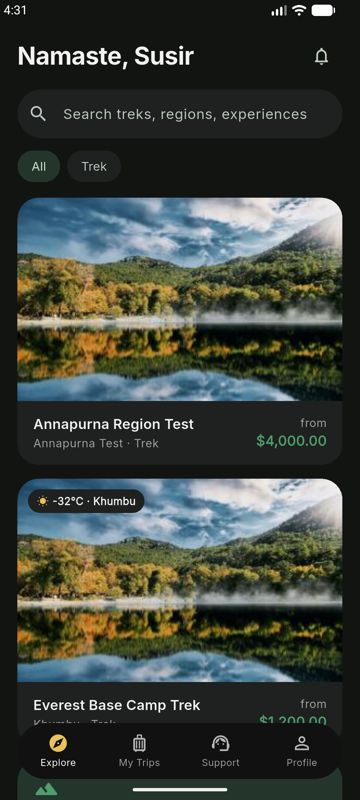
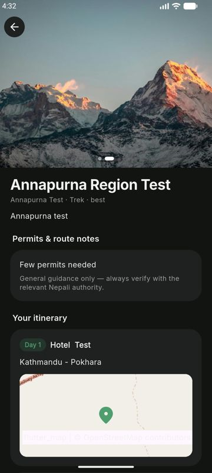
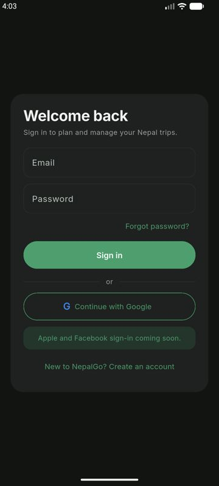
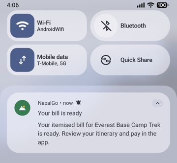
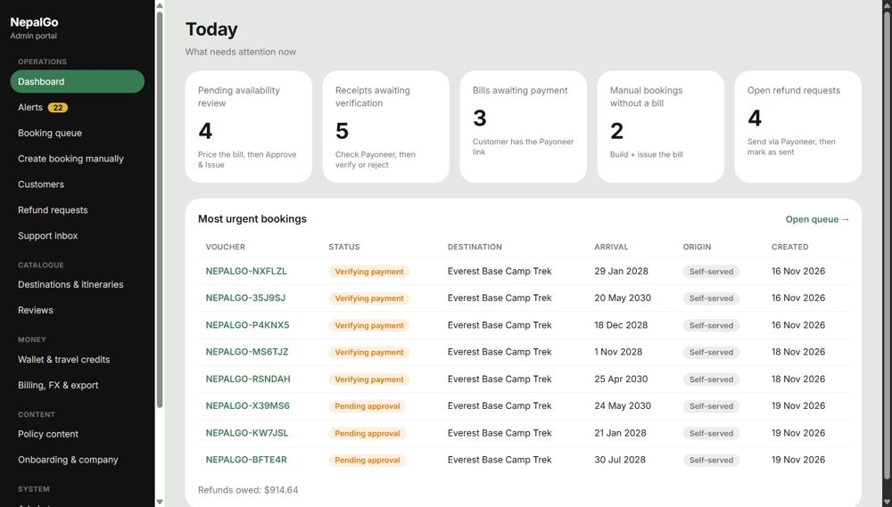
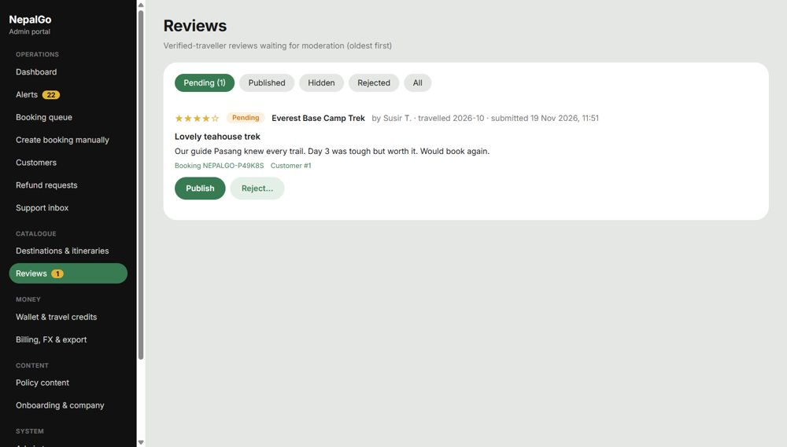
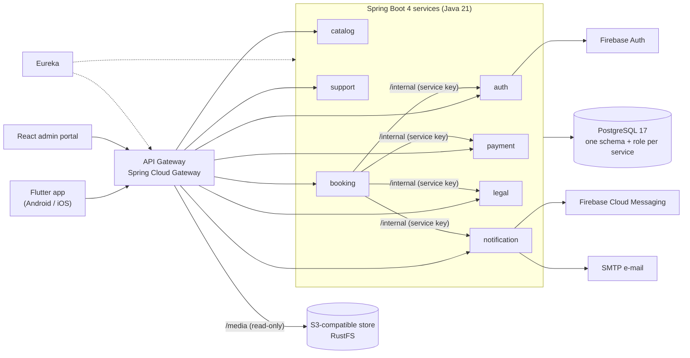

# NepalGo

**A booking platform for hand-planned trips in Nepal:** a Flutter traveller app, a React admin portal, and nine Spring Boot microservices behind an API gateway.

Travellers browse treks, request a trip, review an itemised bill, accept versioned Terms, pay externally (Payoneer) and upload proof of payment. A small operations team approves trips, prices bills, verifies payments, moderates reviews and answers support, all with an audit trail.

<p>
  
  
  
  
</p>
<p>
  
  
</p>

## Architecture



| Service | Owns |
|---|---|
| **auth** | Customer login (Firebase ID token → own RS256 JWT), permanent NepalGo ID, staff login with TOTP MFA, lockout, rate limits, account deletion |
| **catalog** | Destinations, versioned itineraries, photo pipeline (resize, EXIF strip), weather (circuit breaker + cache) |
| **booking** | Booking state machine, cancellation tiers, payment-window expiry job, manual bookings with custom itineraries, verified-traveller reviews |
| **payment** | Itemised bills, FX rates with maker-checker, invoice numbering, PDF invoices, receipts (private bucket, presigned links), travel credits, refunds |
| **legal** | Versioned, immutable Terms/Privacy, consent records, public legal pages |
| **notification** | Event intake, outbox delivery worker (push + e-mail, retries), inbox |
| **support** | Support threads and callbacks behind a feature flag |

## Engineering highlights

- **Security by default.** Separate customer and staff signing keys; every service validates tokens itself with the public key and checks the audience (an MFA-pending staff token can't be replayed). Service-to-service calls use `/internal/**` with a shared key and are never routed through the gateway.
- **Money is handled like a ledger.** Bills are frozen once locked; corrections are separate linked documents. FX rates need a second approval (maker-checker). Travel credits keep an append-only ledger. Amounts use `BigDecimal` end to end.
- **Fail closed across services.** If booking can't reach payment, legal or auth, nothing changes and the admin is told to retry. Calls are idempotent, so a retry never double-issues an invoice.
- **Legal evidence.** Published Terms are hash-fingerprinted and made immutable by a database trigger; consent records store the exact version, hash and per-section timestamps, and can only be appended.
- **Reliable notifications.** Business events go into an outbox; a worker claims rows with `FOR UPDATE SKIP LOCKED` and retries with exponential backoff.
- **Safe user content.** Reviews are pre-moderated and come only from travellers with a finished, confirmed trip. "Add photo by URL" is protected against SSRF (public addresses only on every redirect hop, size and time limits), and every image is re-encoded so no original file or GPS data is kept.
- **Privacy.** In-app account deletion erases personal data across services while keeping tax records; receipts live in a private bucket behind 5-minute presigned links.
- **Operations.** Flyway owns every schema (Hibernate only validates), production config comes from environment variables only, containers run as non-root and refuse to start when a required variable is missing, and backups have a tested restore script.

## Tech stack

| Area | Technology |
|---|---|
| Backend | Java 21, Spring Boot 4, Spring Cloud 2025 (Gateway, Eureka, LoadBalancer), Spring Security (OAuth2 resource server), Spring Data JPA, Flyway, Resilience4j, Bucket4j, OpenPDF |
| Data | PostgreSQL 17, S3-compatible object storage (RustFS) |
| Mobile | Flutter, Riverpod, go_router, Dio, Firebase (Auth, Cloud Messaging), Google Sign-In |
| Admin | React 19, TypeScript, Vite, Tailwind CSS 4, TanStack Query, React Hook Form, dnd-kit, Radix |
| Delivery | Docker / Docker Compose, GitHub Actions (gitleaks, builds for all services, Flutter, admin, container images), nginx |
| Testing | JUnit 5, AssertJ, Testcontainers, Python end-to-end suites, Postman collection + Postman CLI smoke test |

## Run it locally

Prerequisites: Java 21, Docker Desktop, Node 20+, Flutter 3.x.

```powershell
# 1. Infrastructure: Postgres, image store, local mail catcher
docker compose up -d

# 2. Services (each from the repo root; IntelliJ run configs work too)
.\build-all.ps1
docker compose --profile app up -d --build   # or run services individually

# 3. Admin portal
cd admin-frontend; npm install; npm run dev   # http://localhost:5173

# 4. App (Android emulator)
cd mobile-app; copy dart_defines.example.json dart_defines.json   # add your Firebase web API key
.\build-android.ps1
```

Secrets (`.env`, JWT keys, Firebase files) are not in the repository. See **[RUNBOOK.md](RUNBOOK.md)** for the full list of environment variables, deployment, backups and troubleshooting, and **[mobile-app/README.md](mobile-app/README.md)** for the optional Firebase setup (Google sign-in, push).

## Testing

- **Unit and integration tests** per service (`.\mvnw.cmd test`), including Testcontainers tests against real PostgreSQL with the real migrations.
- **End-to-end suites** ([tests/e2e](tests/e2e)) drive real flows through the gateway and check the resulting database rows, audit entries and e-mails: billing, credits, legal consent, admin, notifications, MFA, account deletion, reviews, payment window, custom itineraries.
- **Smoke test:** `.\postman\smoke-public.ps1 [-Gateway https://api.example.com]` runs the read-only public API checks with the Postman CLI; it's safe to run right after a deploy.
- **Flutter:** `flutter analyze` and `flutter test` (widget tests include the photo slideshow timing).

## Project status

Feature-complete for an Android launch: booking lifecycle, billing, payments, legal consent, notifications, support, admin portal, Google sign-in and push. Before going live: Sign in with Apple and iOS signing (needs an Apple Developer account), production hosting, and a legal review of the Terms. See [docs/APP-STORE-CHECKLIST.md](docs/APP-STORE-CHECKLIST.md).

## Repository layout

```
api-gateway/  eureka-server/  auth-service/  catalog-service/  booking-service/
payment-service/  legal-service/  notification-service/  support-service/
admin-frontend/   React admin portal
mobile-app/       Flutter traveller app
infra/            Postgres init scripts, backup/restore
postman/          API collection + smoke test
docs/             Store checklist, screenshots
```

---

Built by [@susir11](https://github.com/susir11).
