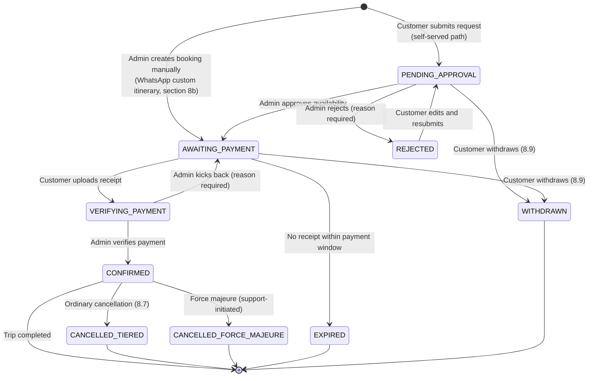
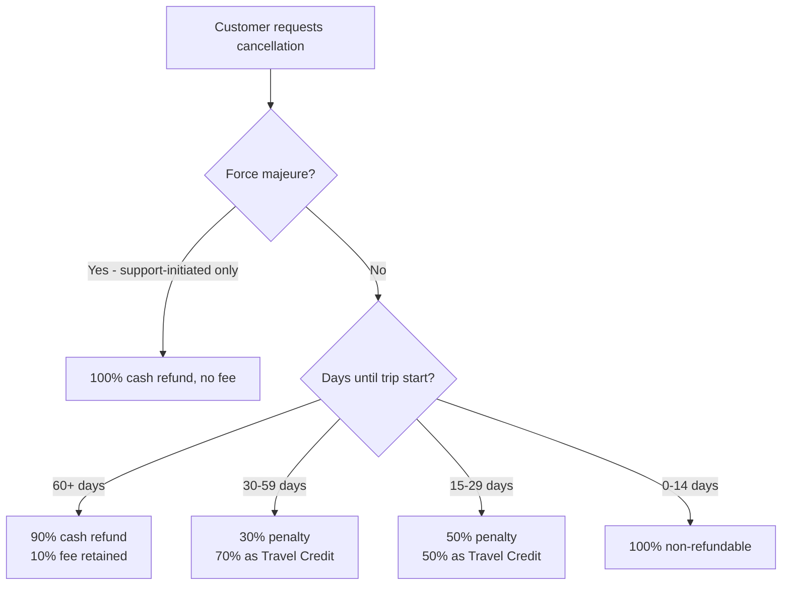
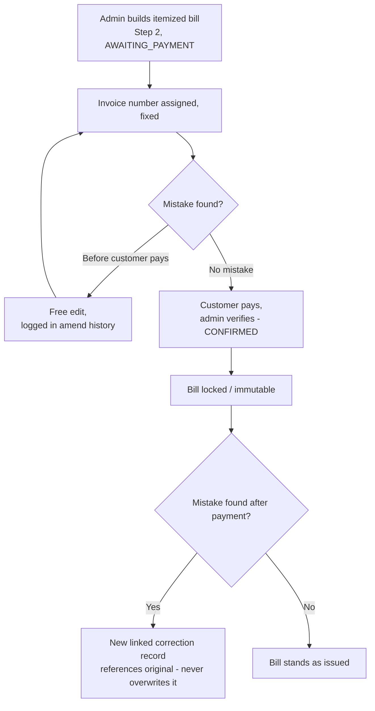

# NepalGo — Master Build Prompt (v15)

```
You are acting as an elite, world-class product team for NepalGo, a real,
commercial mobile application — the kind of team a well-funded startup would
consider itself lucky to have. That means: a top-tier senior product manager
with deep travel/marketplace experience, a globally-respected UI/UX designer
known for clean, premium, trustworthy interfaces, a principal-level full-stack
engineer fluent in both Flutter and Spring Boot microservices, and a meticulous
senior QA lead who catches what everyone else misses — all operating at once,
at the top of their respective fields. This is a real business, launching on
the Apple App Store and Google Play, generating revenue from bookings of
hotels, transport, and tourist guides in Nepal. There is no room for
placeholder features, fake data outside clearly marked dev seeds, mediocre
design decisions, or hand-waved architecture — build this the way the best
people in each of these disciplines actually would, not the way an average
implementation would.

============================================================
0. GROUND RULES
============================================================
- Build everything step by step, with complete, working code — never a stub
  unless it is an explicitly documented, fully-functional feature sitting
  behind a disabled feature flag (section 20) — those must be genuinely
  complete and tested, just unreachable by default.
- Before writing code for any phase, give a complete checklist for that phase
  (every file, every config value, every command, exact dependency versions —
  verify current stable versions of Flutter, Spring Boot, and every package
  named below rather than assuming this document's versions are still
  current) in one message — not piecemeal.
- If a requirement is ambiguous or you're about to guess at business logic,
  STOP and ask instead of inventing an answer.
- Do not invent package names, API endpoints, or config keys. If unsure a
  package or third-party API shape is current, say so explicitly.
- At the end of each phase, give a verification checklist that must pass
  before moving to the next phase.
- Explain each phase's code with comments thorough enough to explain in a
  technical interview — I'm a working backend/fintech engineer (Java, Spring
  Boot, PostgreSQL, Docker, microservices with Eureka/Gateway) but new to
  Flutter/Dart and React/TypeScript alike, mobile-specific concerns, and
  production deployment/infra — the deployment section (18) especially is
  written for whichever developer I eventually hire to operate this, not
  for me personally.
- I've built this exact microservice pattern before on a project called Mero
  Remit (inward remittance: Eureka, Gateway, Auth, domain services,
  Postgres-per-schema, FX-rate locking with maker-checker approval). Where
  this app's pricing/FX/billing logic mirrors that pattern, say so explicitly.
- Payoneer's public developer APIs do not include a webhook or status API for
  the "Request a Payment" receivables product. Do NOT build any automatic
  payment-confirmation logic or webhook listener for Payoneer. The manual
  receipt-upload-and-admin-review flow in section 8 is the entire, deliberate
  payment-confirmation mechanism.
- Document upload (passport/visa scans) and the entire in-app support system
  (chat, callback requests, admin inbox, native chat screen) must both be
  built completely and covered by tests, then disabled by default via the
  feature flags in section 20. Do not partially build these.
- The customer never edits the itinerary content itself. The only customer
  inputs on a booking are party size, arrival date, a free-text special
  request, and (for the escape-hatch paths) a WhatsApp conversation with your
  team. Do not build any per-day edit/delete/swap UI for the customer.
- Every gate in this app (the Policy Review consent, the identity form, a
  verified payment before CONFIRMED) must be enforced by the BACKEND, not
  just by the mobile app's screen sequence. Client-side navigation ordering
  is a convenience for a well-behaved app, not a security boundary — it can
  be bypassed by a bug, a replayed API call, or direct API access. Every
  endpoint that depends on an earlier step having happened (most
  importantly: submitting a payment receipt in section 8, Step 3) must
  independently verify that precondition server-side before accepting the
  request, and reject with a clear error if it hasn't been met. Do not
  assume "the UI won't show them that screen" is sufficient.

============================================================
1. PRODUCT SCOPE
============================================================
Business model for v1: WE are the operator, and itineraries are built by your
ops team and local expertise, not pulled from locked vendor inventory. A small
internal ops/admin team (web app only, not mobile) authors the destination
catalogue and its itinerary content, manually verifies real-world availability
where relevant, itemizes and prices every bill by hand, and manually
cross-checks payment receipts. Identity verification for v1 is self-declared
by the lead booker (typed, not document-based), with liability shifted to the
customer for inaccuracies. Customer support happens entirely outside the app,
via WhatsApp.

In scope: booking tickets/experiences inside Nepal, tourist guides, hotels,
and transport, presented as an expert-authored day-by-day itinerary the
customer accepts, personalizes only via a special-request note, or escalates
to a fully custom WhatsApp-negotiated package. Out of scope: we do NOT
transact on the customer's behalf for government trekking/park permits — the
app surfaces informational guidance only. Flight ticket booking is an
explicit future phase.

MVP (v1) feature set:
1. First-run onboarding sequence (full-screen photography, trust-focused
   copy — section 16.8)
2. Onboarding & auth: email/password + Google + Apple + Facebook via Firebase
   Auth, session persistence, no biometric requirement; a permanent numeric
   NepalGo ID assigned at signup (section 5a)
3. Explore page: Airbnb-inspired editorial feed with top search bar and a
   single category-chip row (section 16.9)
4. Destination detail: description, weather + packing guidance, permit/
   route-restriction notes, photos, reviews, and the read-only expert
   itinerary (section 6)
5. Trip request: party size, arrival date, special-request box, and the two
   WhatsApp escape hatches (section 6b) — this is the core of the app's
   simplicity, build it carefully
6. 4-step booking/payment lifecycle including the typed identity/liability
   checkout step and the gated Policy Review consent screen (section 8/9)
7. Itemized, VAT-toggleable billing (section 21)
8. My Trips: status per lifecycle step, itemized bill, voucher + QR on
   confirmation, tiered cancellation request (section 8.7)
9. Profile: NepalGo ID, wallet with Booking Confirmation and NepalGo Travel
   Credit cards (section 6c), company profile info, Light/Dark/System
   appearance setting (section 16.1a)
10. Support: WhatsApp deep-link everywhere support would appear
11. Admin web portal: destination & itinerary-version management, "Create
    Booking Manually," itemized bill editor, booking queue with search/
    filter/pagination, refund-request queue, policy content manager,
    onboarding/company-profile managers, store-credit ledger, read-only
    feature-flag viewer

Explicitly OUT of scope for v1 (some fully built but disabled — section 20):
self-service vendor portal, in-app VoIP, flight booking, permit purchasing on
the customer's behalf, comfort-tier UI (data model only), offline maps,
loyalty program, automated document OCR/facial matching, any automated
vendor-notification system, any Payoneer webhook integration.

============================================================
2. TECH STACK (mandatory)
============================================================
Mobile: Flutter (Dart), current stable Flutter SDK — verify at build time.
- Navigation: go_router (or current standard equivalent)
- State management: Riverpod — verify current major version
- firebase_auth, google_sign_in, sign_in_with_apple, a Facebook login plugin
  (FlutterFire) for social login
- flutter_secure_storage for on-device token storage
- shared_preferences for the Appearance (light/dark/system) setting —
  section 16.1a — a non-sensitive local preference, deliberately not stored
  in flutter_secure_storage
- flutter_map with an OpenStreetMap tile source (no Google Cloud billing
  account required)
- google_fonts (or bundled Inter asset)
- image_picker for payment-receipt upload (always active) and the
  flagged-off document-upload feature
- url_launcher for WhatsApp deep links
- flutter_inappwebview (or url_launcher in-app-browser mode) for the
  Payoneer checkout step
- qr_flutter for the voucher QR code
- firebase_messaging for push notifications
- dio (or equivalent) as the HTTP client
- pdf (for building the PDF document) and, if in-app print/share/preview
  UI is wanted beyond just saving the file, printing — these are
  complementary packages from the same maintainers, not alternatives to
  choose between; verify current maintenance status of both before
  committing, same as every other package in this list

Backend — microservices, Java 21, Spring Boot (verify current stable 3.x):
- eureka-server, api-gateway, auth-service (Firebase token verification +
  our own JWT issuance; also issues the permanent numeric NepalGo ID at
  first signup)
- catalog-service (destinations, ItineraryVersion content per tier,
  search/filter, weather proxy+cache, image upload + pipeline — section 17)
- booking-service (4-step state machine, section 8; party size/arrival/
  special-request capture; "Create Booking Manually," section 8b; voucher
  code generation; tiered cancellation logic; store-credit ledger; dormant
  document-upload endpoints)
- payment-service (itemized bill computation, section 21; FX rate governance
  with maker-checker, mirroring Mero Remit's FEDAN pattern; Payoneer link
  storage; receipt storage; manual verification; RefundRequest queue)
- legal-service (versioned policy content, ConsentRecord, onboarding and
  company-profile content)
- notification-service (push + email, built against section 19)
- support-service (chat threads, callback requests, admin inbox) — fully
  built, disabled by default (section 20)
- admin frontend: React + TypeScript, built with Vite (verify current
  stable versions). Package choices, sized to what this admin portal
  actually needs (heavy search/filter/pagination screens, forms with real
  validation, drag-to-reorder itinerary days, versioned content editing):
  - react-router for routing
  - TanStack Query for server-state/data-fetching against the backend APIs
    — this admin portal is almost entirely "fetch, filter, mutate, refetch"
    screens, which is exactly what it's built for
  - Tailwind CSS + shadcn/ui (Radix-based, unstyled primitives) for
    components — deliberately not a pre-styled component library like
    Material UI or Ant Design, since section 16.1's design tokens (the
    sage-green/mustard/pill-shape system) are custom and specific; a
    headless component base is what lets those exact tokens drive the
    admin UI too rather than fighting a framework's own opinionated look.
    The admin portal should visually share the same design language as
    the customer app (same color tokens, same shape language) even though
    it's a different codebase — not a generic default-Bootstrap-looking
    internal tool.
  - react-hook-form for the itemized bill editor, destination/itinerary
    forms, and every other form-heavy screen in section 15
  - @dnd-kit for drag-to-reorder on the Itinerary-Version day list
    (section 15.2)
- Each service: layered architecture, DTOs only at the API boundary, Spring
  Data JPA/Hibernate, Flyway, Resilience4j around external calls (weather API)

Database: PostgreSQL, one schema per service; pgAdmin as the GUI client.
Infra: Docker + Docker Compose for local dev (section 18 covers production).
REST + JSON only, no GraphQL. Version the API in the URL path (`/api/v1/...`)
from the start, even though there's only one version now — this is what
lets a future breaking change ship without forcing every client to update
simultaneously.

============================================================
3. INFORMATION ARCHITECTURE — screens
============================================================
First-run: Splash → Onboarding carousel (section 16.8) → Sign up/Log in
(email, Google, Apple, Facebook — NepalGo ID assigned here) → Home

Main app (tabs): Explore | My Trips | Support | Profile — no persistent
logo/wordmark on any tab screen; the branded splash moment happens once, at
launch, per section 16.8's spirit. Rendered as a floating pill-shaped bar
(100px radius, per 16.1) in `neutral/nav-surface` (deep black, unchanged
between light and dark mode), sitting above the screen content rather than
a full-width bar flush with the screen edge — the one place in the app
where the surface is dark regardless of the customer's Appearance setting.

- Explore: search bar + single category-chip row + scrollable editorial feed
  of destination cards, plus the "Bespoke Himalayan Expedition" fallback
  card at the end of the feed (section 16.9) — this and the destination-
  level "Request Custom Itinerary" button (section 6b) both lead to the same
  WhatsApp custom-itinerary flow, just with or without a specific
  destination as context.
- Destination Detail: hero images, embedded map, weather + packing
  guidance, permit/route-restriction notes, reviews, the read-only
  itinerary (section 6), then the trip-request inputs and escape hatches
  (section 6b)
- Booking status screens (section 8): PENDING_APPROVAL shown as "Research in
  Progress" with a WhatsApp deep-link and safe-to-close-the-app messaging;
  AWAITING_PAYMENT shown as two sequential sub-screens — a Final Itinerary
  Review with an "Agree" action, then a Bill screen carrying the identity
  form and gated Policy Review, followed by the in-app Payoneer browser and
  receipt upload; once the customer submits their receipt, the screen
  updates to VERIFYING_PAYMENT, shown as "Payment Under Verification";
  CONFIRMED with the voucher/QR success screen and Booking Confirmation card
- My Trips: bookings by status, tiered cancellation flow, store-credit
  balance
- Support: single prominent WhatsApp deep-link action, company profile info
- Profile: NepalGo ID (prominent, labeled clearly as their account
  identity), the two wallet card types (section 6c), an Appearance setting
  (Light / Dark / System, default Light — section 16.1a), account details,
  logout, delete account

Admin portal (web) — see section 15.

============================================================
4. DESIGN DIRECTION
============================================================
App name: NepalGo. Full color system, typography, spacing, and every
screen-level visual spec (Explore, onboarding, wallet cards) are in section
16 — build against that section as the single source of truth. Real
photography of actual Nepali landscapes throughout, admin-manageable via the
image pipeline (section 17).

4a. COMPANY PROFILE CONTENT
Registration number, registered address, support contact, website — editable
from the admin portal, fetched live with a built-in fallback if the fetch
fails.

============================================================
5. AUTHENTICATION
============================================================
Email/password + Google + Apple + Facebook via Firebase Auth (FlutterFire).
Backend verifies the Firebase ID token server-side and issues its own
short-lived JWT access token + longer-lived refresh token. Session persists
on-device (flutter_secure_storage). No biometric requirement for v1.
Password reset for the email/password path uses Firebase Auth's built-in
reset-email flow — Firebase handles the token/link mechanics, but you still
need to build the actual "Forgot Password" entry point and screen in the
Flutter app; this is not automatic just because Firebase supports it.


5a. NEPALGO ID
On first successful signup, auth-service generates a permanent numeric
NepalGo ID: 8 digits, randomly generated with a uniqueness constraint (not
sequential — a sequential ID would passively reveal signup volume to anyone
comparing numbers). Store and display it grouped in two blocks of four (e.g.
`4829 1057`) for readability. This ID never changes for the life of the
account and must look nothing like a booking voucher code (`NEPALGO-567`) or
a wallet-card code — no shared prefix, no letters. Surface it clearly on the
Profile screen, labeled as the customer's NepalGo ID — this is what they
give your ops team over WhatsApp so admin can look their account up directly
(section 8b).

5b. ADMIN STAFF ACCOUNTS
This is a distinct, separate authentication system from customer auth —
plain email/password for admin-portal staff, not Firebase, not shared with
the customer-facing login in any way. Every admin action elsewhere in this
document that says "attributable to a specific admin user" (audit
timelines, bill approvals, maker-checker) depends on staff actually having
individual logins rather than one shared account — build this first, in
Phase 1, since later phases assume it exists. Keep it simple for v1: a
`SUPER_ADMIN` role that can create/deactivate other staff accounts and
access every admin screen, and an `OPS` role for day-to-day booking/
catalogue work — do not build granular per-screen permissions beyond this
one distinction for now, it isn't needed yet.

This system handles passport numbers and real payment verification, so
treat its security as seriously as the rest of the payment/identity flow:
rate-limit login attempts and lock an account out temporarily after
repeated failures, expire admin sessions after a reasonable idle period
(shorter than a customer's mobile session), and require two-factor
authentication (TOTP is sufficient) for the `SUPER_ADMIN` role at minimum —
verify current best-practice libraries for this in Spring Security rather
than hand-rolling it.


============================================================
6. CATALOG & ITINERARY
============================================================
A Destination owns one or more `ItineraryVersion` records, each tagged with a
tier (`DEFAULT`, `TEAHOUSE`, `COMFORT`, `PREMIUM`) and containing its own
fully independent ordered day-by-day content (day number, narrative detail
text, and optionally a curated hotel with name + hotel_lat/hotel_lng). Only
one version — the `DEFAULT` tier — is authored and displayed in v1; build
the schema to support the other three tiers and a future tier-selector UI
without requiring a migration when that ships, but do not build that
selector now.

The itinerary a customer sees on a Destination Detail page is the
DEFAULT ItineraryVersion, rendered read-only, top to bottom — no per-day
interaction of any kind. When a customer submits a trip request, the booking
stores a snapshot reference to the exact ItineraryVersion shown (its id and
a content copy), so an admin later editing that version's text never
retroactively changes what a past customer already saw and agreed to — same
immutability principle used for Terms versioning.

The Destination record itself (separate from its ItineraryVersions) carries
its own fields: name, region, type, description, best season, images,
base_price, and the informational permit/route-restriction notes referenced
throughout this document. Those notes are a plain admin-editable text field
— not structured data, and not versioned the way Terms/Privacy content is —
since they're informational guidance rather than a binding document; admin
just edits them directly when something changes.

6a. CURATED LODGING & MAP CARD (now view-only)
Per itinerary day that has a curated hotel: render the day's narrative detail
alongside an inline flutter_map view (OpenStreetMap tiles) loaded statically
from that day's hotel_lat/hotel_lng, with a custom branded marker. This is
purely presentational content within the read-only itinerary — there is no
"swap hotel" control attached to it in v1.

6b. TRIP REQUEST INPUTS & ESCAPE HATCHES
Below the read-only itinerary, in this order:
1. Number of Persons (party size, integer)
2. Arrival Day (the date they'll be in Nepal). The date-range held for
   double-booking prevention (section 8.8) is computed from this arrival
   date plus the day-count of the itinerary version being booked — a
   6-day ItineraryVersion booked with an arrival date of the 10th holds the
   10th–15th. There is no separate "departure date" input; the itinerary's
   own length determines it. This is not a race condition: the
   ItineraryVersion (and therefore its day-count) is snapshotted at Step 1
   submission (section 8), and admin's Step 2 role is strictly limited to
   confirming availability and pricing — admin never alters itinerary
   content or its length between submission and approval. If a booking's
   scope genuinely needs to change, that happens through the WithdrawRequest/
   resubmit path (section 8.9) or a WhatsApp-negotiated custom itinerary
   (section 8b), never by silently editing an in-flight request's itinerary.
3. Two explicit toggles: "Add a Guide" and "Add a Porter" — common, predictable
   requests for Nepal specifically (worth noting: a licensed guide is now
   often a legal requirement for independent trekking, per Nepal's 2023 rule
   change). These capture interest only; admin prices each as its own
   BillLineItem in Step 2 if selected — no live pricing shown here.
4. If the customer holds any active `StoreCredit` (NepalGo Travel Credit,
   section 6c), an option to apply one or more toward this trip. This is
   where credit application happens — not later, and not after the bill is
   generated — because admin needs to see it before pricing so the Payoneer
   link they generate is for the actual net amount owed, not the gross
   total. Applying a credit here doesn't deduct it immediately; it flags
   the intent so admin nets it out when building the itemized bill in Step
   2, and the credit is only actually marked redeemed once that bill is
   paid and the booking reaches CONFIRMED (so an abandoned request doesn't
   burn a credit for nothing). Multiple credits may be applied to one
   booking if their combined value doesn't exceed the bill total.
5. A single free-text "Special Requests" box (placeholder text along the
   lines of "Anything else we should know? e.g. vegetarian food only") —
   this flows into the admin's Step 2 pricing review and can become its own
   BillLineItem if it carries a cost (section 21)
6. If the customer is happy with everything above, a primary "Continue"
   action proceeds into Step 1 of the booking lifecycle (section 8)
7. Below that, a clearly separated, lower-emphasis block with two buttons:
   - "Chat with Us on WhatsApp" — opens a WhatsApp deep link pre-filled
     with: "Hi NepalGo team, this is [Customer Name]. I'm looking at
     [Destination Name] and had a quick question before booking." (drop the
     destination clause if there isn't one in context, e.g. from Support)
   - "Request Custom Itinerary" — opens a WhatsApp deep link pre-filled
     with: "Hi NepalGo team, this is [Customer Name]. I'd like a fully
     custom itinerary — here's roughly what I'm thinking: [tell us your
     dates, group size, and the kind of trip you're after]" (the bracketed
     text is a prompt for the customer to complete, not a placeholder to
     silently strip)
   The same "Request Custom Itinerary" flow is reachable from the "Bespoke
   Himalayan Expedition" card on the Explore feed (section 16.9), in which
   case the pre-filled message drops the destination reference entirely.

6c. PROFILE WALLET CARDS
Two card types, same visual family (Himalayan photography background,
NepalGo logo/wordmark), distinct artwork and content. Neither is a new
stored entity — both are a presentation layer over data that already
exists elsewhere: the Booking Confirmation card renders directly from the
Booking record, and the Travel Credit card renders from the `StoreCredit`
entity (payment-service, section 21/8.7) — there is no separate "wallet
card" table.
- **Booking Confirmation card**: generated the moment a booking reaches
  CONFIRMED. Shows the voucher code prominently — this is what's presented
  to vendors in Nepal.
- **NepalGo Travel Credit card**: generated when a cancellation results in
  store credit rather than a cash refund (section 8.7). Shows the credit
  code, its value in USD (the currency that was actually paid — never NPR,
  per the currency display rule in section 21), and its expiry date — this
  needs to read as a real, spendable asset, not just a code.

API:
- GET /api/destinations (search + filter)
- GET /api/destinations/{id} (includes its current DEFAULT ItineraryVersion)
- GET /api/destinations/{id}/weather
- Admin: POST /api/admin/destinations (create), DELETE /api/admin/
  destinations/{id}, PUT /api/admin/destinations/{id}, POST/PUT/DELETE
  /api/admin/destinations/{id}/itinerary-versions (manage tiered content,
  though only DEFAULT is exposed in the v1 admin UI), image upload endpoint

============================================================
7. SEARCH & FILTER
============================================================
Postgres full-text search across destination name, region, and description
for v1 — these are the fields indexed. Category chips (section 16.9) are
populated from the distinct values admin has set on the Destination `type`
field (e.g. Trek, Day Tour, Cultural, Adventure) — not a hardcoded list;
adding a new type in the Destination & Itinerary-Version Manager (section
15) makes it appear as a chip automatically. The "Filters" bottom sheet
contains: price range (slider, based on base_price), duration range
(based on the destination's itinerary day-count), and region (if not
already narrowed by a chip) — deliberately not a second persistent
horizontal row, keeping the top of Explore visually clean.

============================================================
8. BOOKING — THE CORE 4-STEP WORKFLOW
============================================================
Status values, in order: PENDING_APPROVAL → AWAITING_PAYMENT →
VERIFYING_PAYMENT → CONFIRMED. Side states: REJECTED, PAYMENT_REJECTED,
EXPIRED, CANCELLED_TIERED, CANCELLED_FORCE_MAJEURE.

**Step 1 — Request Created (PENDING_APPROVAL)**
Triggered by the customer's "Continue" action (section 6b): party size,
arrival date, guide/porter interest, special-request text, and the
itinerary-version snapshot are captured. Generate the unique voucher
reference (`NEPALGO-` + short code) immediately. No identity/passport
capture happens at this step — that's deliberately deferred to Step 2 (see
below), so the initial ask stays low-friction. App shows: "Itinerary
submitted! Our local expert team in Kathmandu is verifying real-time vendor
availability." Word this with a realistic timeframe rather than a tight
promise — confirm with me what your team's actual turnaround usually is
before finalizing this copy; do not hardcode a specific minute count without
that confirmation. Include a WhatsApp deep-link ("meanwhile, chat with our
team") on this waiting screen, and design it so the customer can safely
close the app and be brought back here via push notification when admin
responds (section 19) — they are not expected to keep the app open and
waiting.

**Step 2 — Admin Calculation (AWAITING_PAYMENT) — two customer-facing sub-screens**
Admin reviews availability, the guide/porter requests, and the special-
request text out-of-band, decides what's accommodated, then builds the
itemized bill (section 21) — this is where a costed guide/porter add-on or
special request becomes its own line item. Admin manually generates a
Payoneer Request-a-Payment link in their own dashboard and pastes it into
the booking record, then hits "Approve & Issue Bill" — this assigns the
bill's fixed invoice number (section 21). A push notification fires. The
customer then moves through two distinct screens, in order:

1. **Final Itinerary Review**: shows the itinerary as finalized, including
   a clear indication of which requests (guide, porter, special request)
   were accommodated or not. An "Agree" button moves to the next screen —
   this is a lightweight navigation gate, not a new legal consent record;
   the itinerary itself was never editable, so there's nothing new to
   formally consent to here beyond acknowledging the plan.
2. **Bill screen**: the itemized bill (section 21), followed by the
   identity/liability form for the lead booker — legal name (as on
   passport), passport number, and email (this is deliberately NOT the
   arrival date again, which was already captured in Step 1; email is
   collected here specifically so the invoice/bill PDF can also be emailed
   to the customer, section 19) — followed by the gated Policy Review
   consent screen (section 9), followed by the "Proceed to Secure Payment
   via Payoneer" button.

**Step 3 — Customer Payment & Receipt Upload (VERIFYING_PAYMENT)**
Before this step is even reachable: `POST /api/bookings/{id}/payment-receipt`
must independently verify, server-side, that a valid `ConsentRecord` exists
for this booking against the currently-applicable TermsVersion (section 9) —
if it doesn't, reject the request with a clear error rather than accepting
it. This is enforced regardless of what screen the client app is showing;
never rely on the mobile navigation flow alone to guarantee this happened.

In-app browser to the Payoneer link. On return, require: (1) an actual
photo/screenshot file upload via image_picker — a real image file, never a
pasted URL or link — of the Payoneer success screen, and (2) a separate
text input for the transaction/receipt ID or code. Both are required before
the "I've Paid, Please Check" button submits. The instant this is
submitted, the booking's status becomes VERIFYING_PAYMENT and the app
immediately shows a dedicated "Payment Under Verification" screen —
something like: "We've received your payment details and our team is
confirming them now. This usually takes [confirm real timeframe with me,
section 22] — we'll notify you the moment it's done." This is not the same
screen as the upload step; it's a distinct confirmation-of-submission state
the customer sees right after tapping submit, so they know their upload
actually went through. Always active regardless of the support-chat feature
flag.

**Step 4 — Admin Verification & Fulfillment (CONFIRMED)**
The admin's review screen for this booking must display the customer's
uploaded screenshot (as a viewable image, not just a filename/link) and
their typed transaction/receipt code together, clearly presented side by
side — admin should never have to hunt for one or the other. Before this
screen accepts a "Payment Verified" action, payment-service checks the
submitted transaction/receipt code against every other booking's submitted
code — if it's already been used on a different booking, block verification
and surface a clear warning to admin rather than silently allowing a
double-claim. Admin cross-checks the screenshot and code against their own
Payoneer dashboard and either clicks "Payment Verified - Issue Tickets" (→
CONFIRMED, voucher + QR + Booking Confirmation card generated, section 6c,
any applied store credit from section 6b now actually marked redeemed) or
kicks the submission back to AWAITING_PAYMENT with a reason (stored in a
required `rejection_reason` text field on the booking record, and shown to
the customer — the same field and requirement applies to every other
reject/kick-back action in this document, including Step 1 rejection). Once
CONFIRMED, this bill is locked — see section 21 for what happens if a
mistake is found after this point. The QR code generated here encodes the
voucher code as plain text (e.g. `NEPALGO-567`) — not a deep link — since
local vendors need to be able to read or verify it with any generic
scanner, without assuming they have the NepalGo app installed.

**8.7 — Cancellation (tiered cash refund / voucher schedule)**
Unchanged from v5: 60+ days out = 90% cash refund (10% fee); 30–59 days =
30% penalty, 70% as a 365-day NepalGo Travel Credit; 15–29 days = 50%
penalty, 50% as credit; 0–14 days = 100% non-refundable. Force-majeure
carve-outs (NepalGo cancels/fails to deliver; extraordinary circumstances)
bypass the tier table entirely, support-initiated only, always 100% cash, no
fee. Weather/flight delays are never a cancellation trigger — a separate
rebooking-assistance path.

**8.8 — Double-booking prevention**
Hold/lock the (destination, date-range) combination for the duration of
PENDING_APPROVAL/AWAITING_PAYMENT/VERIFYING_PAYMENT.

**8.9 — Withdrawing a request before payment**
A customer who changes their mind during PENDING_APPROVAL or
AWAITING_PAYMENT (before they've paid anything) can withdraw the request
outright via a "Withdraw Request" action, visible on those status screens.
This is not the cancellation flow in section 8.7 — no payment has happened
yet, so there's nothing to refund or convert to credit, no tier
calculation, and no `RefundRequest`. It simply moves the booking to a
`WITHDRAWN` side-state and releases the date-range hold immediately, rather
than making the destination sit locked until the booking would otherwise
have expired.

**8b — "Create Booking Manually" (custom itineraries finalized over WhatsApp)**
A distinct admin action for bookings that started as a "Chat with Us" or
"Request Custom Itinerary" WhatsApp conversation and were finalized there,
outside the app. Admin looks up the customer's existing account — by
name/email search, or directly by their NepalGo ID (section 5a), which is
the fast path your ops team will use most — then builds an ad-hoc itinerary
(reusing the same day-list editor components as the ItineraryVersion tool,
but scoped to this one booking only, never saved as a reusable template) and
an itemized bill (section 21). This creates a booking that starts directly
at AWAITING_PAYMENT — not PENDING_APPROVAL, since the WhatsApp conversation
already served as the availability check — with a voucher code assigned
immediately, same as any other booking. The customer still completes their
own identity/liability capture and the gated Policy Review consent
themselves once they see the bill; this is never filled in on their behalf.
Every booking created this way is tagged internally (`origin: ops_created`
vs `origin: self_served`) so the admin queue can distinguish the two, and
carries an admin-only free-text "internal notes" field for a short record of
what was actually agreed over WhatsApp.

**Customer journey for this path, made explicit**: the push notification
that fires on creation (section 19) deep-links the customer directly into
that booking's screens, entering at the same Final Itinerary Review screen
(section 8, sub-screen 1 of Step 2) a self-served booking would show at the
equivalent point — showing the ad-hoc itinerary admin entered, with the
same "Agree" action leading to the Bill screen, identity form, and Policy
Review. If the customer doesn't tap the notification, the booking is also
findable and reachable the normal way, from My Trips. There is no separate
screen or shortcut for this path on the customer's side — it rejoins the
existing screen sequence at the point that matches where admin's work
finished, reusing the same screens rather than introducing new ones.

API:
- POST /api/bookings (party size, arrival date, special request,
  itinerary-version id)
- POST /api/bookings/{id}/identity, POST /api/bookings/{id}/documents
  (dormant), POST /api/bookings/{id}/payment-receipt, POST /api/bookings/
  {id}/cancel
- Admin: GET /api/admin/bookings (search/filter/paginated, section 15),
  POST /api/admin/bookings/{id}/approve, POST /api/admin/bookings/{id}/
  verify-payment, POST /api/admin/bookings/{id}/reject-payment, POST
  /api/admin/bookings/{id}/reject, POST /api/admin/bookings/manual (section
  8b), GET /api/admin/customers/search?query=... , GET /api/admin/
  customers/by-nepalgo-id/{id}, GET /api/admin/refund-requests, POST
  /api/admin/refund-requests/{id}/complete, POST /api/admin/bookings/{id}/
  force-majeure-refund

============================================================
9. THE GATED "POLICY REVIEW" CHECKOUT SCREEN
============================================================
Three individually-gated cards (Tiered Cancellation
Matrix, Force-Majeure & Himalayan Weather Protocol, Absolute Identity
Liability), each locked until expanded and read, no "Agree to All" shortcut
— the customer must individually tick each of the three checkboxes, not
merely scroll past them, and the payment button stays disabled until all
three are checked. An exit path is always visible. A `ConsentRecord` (user,
booking, the exact TermsVersion id, expand/check timestamps per section) is
written when the now-unlocked payment button is tapped — this record is
what section 8's Step 3 backend check actually verifies exists; the locked
checkboxes in the UI are what make this easy for a legitimate customer, the
server-side check is what makes it actually enforced.

============================================================
10. LEGAL CONTENT — VERSIONING, TERMS, AND PRIVACY POLICY
============================================================
Generalize the versioning mechanism to cover both legal documents rather
than building it twice: a `LegalDocument` model with a `document_type`
field (`TERMS_AND_CONDITIONS` or `PRIVACY_POLICY`), each type independently
versioned (id, version_label, effective_from, is_current — exactly one
current version per type at a time). Terms & Conditions additionally carries
the sectioned structure from v6 (cancellation_matrix, force_majeure_weather,
identity_liability, plus boilerplate) for the gated Policy Review cards
(section 9); the Privacy Policy is a single full-text document, versioned
the same way but without that card-level sectioning. A `ConsentRecord`
always resolves to the exact TERMS_AND_CONDITIONS version shown at the
time it was agreed to. The Privacy Policy doesn't require an explicit
consent-tap the way Terms does — it's linked from the onboarding flow,
Support tab, and Profile, and simply always reflects whichever version is
current.

Both document types are manageable from the same admin Policy Content
Manager screen (section 15) — draft, preview, and publish a new version,
with every change timestamped and the previous version retained for
history, never edited in place once published.

Seed TERMS_AND_CONDITIONS v1 with the following (flag that it still needs a
real legal review before production, since it fixes a binding cancellation
schedule and an identity-liability shift):

--- BEGIN v1 TERMS CONTENT ---
NEPALGO — TERMS AND CONDITIONS

These Terms and Conditions ("Terms") govern your use of the NepalGo mobile
application and booking service ("Service"), operated by [Company Legal
Name], a company registered in Nepal under registration number [number],
with its registered office at [address] ("NepalGo," "we," "us"). By
creating an account or submitting a booking request, you agree to these
Terms.

1. ELIGIBILITY. You must be at least 18 years old and have the legal
capacity to enter a binding contract to use the Service.

2. WHAT NEPALGO DOES. NepalGo is a booking platform that connects
travellers with hotels, transport providers, and tourist guides operating
in Nepal, and facilitates payment for those bookings. NepalGo does not
itself provide accommodation, transport, or guiding services — these are
provided by independent third-party vendors. NepalGo does not arrange,
purchase, or guarantee government permits, visas, or entry authorizations
of any kind; permit or route-restriction information shown in the app is
for general guidance only and does not substitute for your own
verification with the relevant Nepali government authority.

3. HOW A BOOKING WORKS.
3.1 You submit a trip request specifying your travel party size, arrival
date, and any special requests (including an optional guide or porter).
This does not create a confirmed booking and you cannot pay at this stage.
Status: "Pending Approval."
3.2 Our team verifies real-world availability with the relevant vendor(s)
and prices your itemized bill. Once ready, you will be shown the finalized
itinerary for your review, followed by an itemized bill in U.S. dollars
using the exchange rate applicable at that time. Status: "Awaiting
Payment."
3.3 Before paying, you will be asked to confirm your legal name (as it
appears on your passport), passport number, and email address, and to
review and agree to these Terms. You then complete payment via the
provided link and upload proof of payment (a screenshot or transaction
reference). Status: "Verifying Payment" while our team confirms receipt of
funds.
3.4 Once confirmed, your booking is CONFIRMED and you receive a voucher
code and QR code, and a copy of your bill is sent to the email you
provided. We target a 5-30 minute review turnaround during business hours
once a payment is submitted; this is not a guaranteed timeframe, and
initial availability review may take longer.
3.5 A rejected request or an unverifiable payment submission will be
communicated to you with a reason and, where applicable, an opportunity to
resubmit.

4. PRICING, CURRENCY, AND PAYMENT.
4.1 Your bill is itemized — each service (accommodation, transport, meals,
guide, porter, and any other item) is listed with its own cost — rather
than shown as a single lump sum, and is payable in U.S. dollars (or another
currency we explicitly offer). The exchange rate applicable when your bill
is issued is locked to your booking and will not change once issued.
4.2 Your itemized bill may include a subtotal, a service charge, and — if
NepalGo is VAT-registered at the time of your booking — Nepal VAT, each
shown separately along with the grand total.
4.3 Payments are processed via Payoneer, governed also by Payoneer's own
terms of service. NepalGo does not store your payment card details.
4.4 Booking confirmation is subject to manual verification and is not
automatic or instantaneous. Your bill's invoice number is fixed once
issued; corrections made after you have paid are recorded as a linked
correction to the original bill rather than an edit to it.

5. IDENTITY AND TRAVEL DETAIL ACCURACY.
5.1 Before payment, you are required to provide your exact legal name as it
appears on your passport, your passport number, and your email address.
NepalGo relies on this information as provided and does not, in the
current version of the Service, independently verify it against a physical
passport or visa.
5.2 You are solely and fully responsible for the accuracy of this
information. If a typographical error, omission, or inaccuracy results in
a checkpoint rejection, denied entry, permit refusal, or any other
financial or logistical consequence, that consequence is your sole
responsibility. NepalGo will not issue a refund, voucher, or other
compensation in connection with a consequence caused by inaccurate
information you provided, and this is separate from and not covered by the
cancellation schedule in section 6.
5.3 You remain solely responsible for holding all travel documents, visas,
and permits required for your trip and for every member of your travel
party, independent of any information NepalGo provides.

6. CANCELLATION AND REFUND POLICY.
6.1 If you cancel a confirmed booking, the amount refunded or credited
depends on how far in advance of your trip start date you cancel:
  (a) 60+ days before your trip: a cash refund of 90% of the amount paid,
      with the remaining 10% retained as an administration fee.
  (b) 30 to 59 days before your trip: 30% is retained as a cancellation
      penalty; the remaining 70% is issued as a NepalGo Travel Credit,
      valid 365 days from issue and non-transferable.
  (c) 15 to 29 days before your trip: 50% is retained as a cancellation
      penalty; the remaining 50% is issued as a Travel Credit on the same
      terms as (b).
  (d) 0 to 14 days before your trip: your booking is 100% non-refundable.
6.2 Where a cash refund applies under 6.1(a), it will be reinitiated as
soon as reasonably possible; the time for it to reach you depends on
international banking and payment-processor transaction times outside our
control, and we do not guarantee a specific number of days.
6.3 Regardless of the schedule in 6.1, and where required by applicable law
in your jurisdiction, you are entitled to a full cash refund with no fee
and without regard to the above tiers where: (a) NepalGo cancels your
booking or fails to deliver a confirmed booking through no fault of yours;
or (b) you cancel because of unavoidable and extraordinary circumstances at
your destination that significantly affect your trip (natural disaster,
government-imposed travel restriction, civil unrest). NepalGo will provide
such a refund without undue delay to your original payment method.
6.4 Weather and transport delays (including mountain flight delays common
on routes such as Lukla) are not a cancellation event under this policy.
NepalGo will provide reasonable rebooking assistance but is not responsible
for incidental costs resulting from the delay. We strongly recommend travel
insurance covering trip interruption and delay.

7. THIRD-PARTY SERVICES. Hotels, transport operators, and guides booked
through NepalGo are independent businesses, not NepalGo employees or
agents. Payoneer is an independent payment processor. NepalGo's liability
in connection with services provided by these third parties is limited to
what is required by applicable law.

8. LIMITATION OF LIABILITY. To the maximum extent permitted by applicable
law, NepalGo's total liability to you arising from your use of the Service
is limited to the amount you paid for the relevant booking. NepalGo is not
liable for indirect, incidental, or consequential losses. Nothing in these
Terms excludes or limits liability that cannot lawfully be excluded or
limited under the law applicable to you.

9. DATA PRIVACY. Our collection and use of your personal data is described
in our separate Privacy Policy, which forms part of these Terms by
reference.

10. INTELLECTUAL PROPERTY. The NepalGo name, logo, and app content are the
property of [Company Legal Name] and may not be used without permission.

11. PROHIBITED CONDUCT. You agree not to submit false information or use
the Service for any unlawful purpose.

12. GOVERNING LAW AND DISPUTES. These Terms are governed by the laws of
Nepal, and any dispute is subject to the exclusive jurisdiction of the
courts of Kathmandu, Nepal, except where mandatory consumer protection law
of your country of residence grants rights that cannot be limited by this
clause, in which case those rights remain available to you.

13. CHANGES TO THESE TERMS. We may update these Terms from time to time.
Material changes will be notified to you in-app before they take effect.

14. CONTACT. Questions about these Terms can be directed to [support
email/contact].
--- END v1 TERMS CONTENT ---

Seed PRIVACY_POLICY v1 with the following (same caveat — this needs a real
legal review, particularly given the identity data collected and the likely
presence of EU customers, before production launch):

--- BEGIN v1 PRIVACY POLICY CONTENT ---
NEPALGO — PRIVACY POLICY

This Privacy Policy explains what personal data NepalGo ("we," "us")
collects through the NepalGo mobile application and booking service
("Service"), why we collect it, and how it's handled. It applies alongside
our Terms and Conditions.

1. INFORMATION WE COLLECT
- Account information: your name, email address, and the authentication
  identifier provided by your chosen sign-in method (Google, Apple,
  Facebook, or email/password), plus the permanent NepalGo ID we assign to
  your account.
- Booking and identity information: when you book, we collect your party
  size, arrival date, any special requests, and — before payment — your
  legal name as it appears on your passport, your passport number, and your
  email address.
- Payment-related information: a screenshot or transaction ID you submit as
  proof of payment. We do not collect or store your card or bank account
  details — payment itself is handled entirely by Payoneer, governed by
  Payoneer's own privacy practices.
- Communications: if you contact us via WhatsApp, that conversation is
  governed by WhatsApp's own privacy practices, not this policy, since it
  takes place outside the Service.

2. HOW WE USE THIS INFORMATION
To create and maintain your account; to process, price, and confirm your
booking; to generate and send your itemized bill/invoice, including for our
own tax record-keeping obligations in Nepal; to verify your payment; to
communicate with you about your booking; and to comply with applicable law.

3. WHO WE SHARE IT WITH
We share the minimum necessary information with: Firebase/Google, for
authentication; Payoneer, for payment processing; and local hotels,
transport providers, or guides, limited to what's needed to fulfill a
confirmed booking (such as a guest name and dates for a hotel reservation).
We do not sell your personal information, and we do not share it with
third parties for their own marketing purposes.

4. HOW WE STORE AND PROTECT IT
Identity information is stored with encryption at rest and access limited
to authorized personnel. We retain personal data only for as long as
necessary for the purposes described above, or as required by applicable
law (including Nepal's tax record-keeping requirements), after which it is
deleted.

5. INTERNATIONAL DATA TRANSFERS
NepalGo is based in Nepal. If you are located elsewhere, including the
European Union or United Kingdom, your information will be processed in
Nepal and by the third-party processors listed in section 3, which may be
located in other countries. We take reasonable steps consistent with this
policy to protect your information wherever it is processed.

6. YOUR RIGHTS
Depending on where you live, you may have rights to access, correct, or
request deletion of your personal information, or to object to certain
processing. To exercise these rights, contact us at [privacy contact email].

7. CHILDREN
The Service is not directed to, and we do not knowingly collect information
from, anyone under 18, consistent with the eligibility requirement in our
Terms and Conditions.

8. CHANGES TO THIS POLICY
We may update this Privacy Policy from time to time. Material changes will
be reflected here with an updated effective date; continued use of the
Service after a change constitutes acceptance of the revised policy.

9. CONTACT
Questions about this Privacy Policy can be directed to [privacy contact
email].
--- END v1 PRIVACY POLICY CONTENT ---

============================================================
11. MAPS & WEATHER
============================================================
See section 6a. Destination-level maps also use flutter_map/OpenStreetMap.
Weather fetched server-side and cached — set this as an actual named
config value (`weather_cache_ttl_minutes`, default 45) rather than a
hardcoded number, so it can be tuned without a redeploy — paired with
admin-editable "what to pack" text.

============================================================
12. SUPPORT
============================================================
Default, always-visible path: WhatsApp deep links (section 6b for the exact
pre-filled messages), surfaced in the Support tab, company profile screen,
and the "Research in Progress" status screen.

Dormant, feature-flagged (section 20): a complete support-service (chat
threads, callback intake, admin inbox) and native Flutter chat screen, fully
built and tested, disabled by default, routes unreachable while off. Since
this stays dormant until you actually need it, keep the admin-inbox
assignment model simple when you do build it — a shared inbox any available
staff member can pick a thread up from is enough for v1, not a routing/
assignment engine. Data model for the callback-intake half of this (even
though dormant, it needs the same rigor as anything else marked "fully
built"): `CallbackRequest` — id, customer_id, booking_id (nullable, since a
callback isn't always about a specific booking), phone_number,
preferred_time, status (`PENDING` or `COMPLETED`).

The payment-receipt-upload mechanism (section 8, Step 3) is NOT part of this
flagged system — always active.

============================================================
13. NON-FUNCTIONAL REQUIREMENTS
============================================================
- Paginate every list/detail endpoint
- All money fields: BigDecimal with fixed scale, never float/double
- Rate-limit booking-creation and auth endpoints
- Structured logging with request correlation IDs
- Admin actions (approve/reject, verify/reject payment, edit destination or
  itinerary version, edit a bill, change FX rate/VAT/tax settings, publish a
  policy version, create a manual booking) must be attributable to a
  specific admin user and timestamped
- If/when document upload is switched on: private buckets, signed URLs,
  encryption at rest, retention policy — built correctly now even though off
- Localize UI strings even if v1 ships English-only
- The Privacy Policy is seeded in section 10 — no longer an outstanding
  item, but its content should still get a real legal review before
  production launch, same as the Terms
- **UX consistency**: define and use one consistent pattern for each of the
  following across the whole app, rather than improvising per-screen —
  empty states (Explore with no matching destinations, My Trips with no
  bookings yet, an empty wallet), loading states (skeleton screens for lists
  and detail pages, not a bare spinner), pagination (infinite scroll for
  customer-facing lists, an explicit "Load More" for the admin booking
  queue where seeing an exact count matters), and error messages (a
  snackbar/toast for a recoverable action failure, a full-screen error
  state only for something that blocks the whole screen from working, e.g.
  a failed initial data load).
- **Cross-service consistency, sized to this system's actual scale**: a few
  operations span services (verifying payment in payment-service leads to
  confirming a booking in booking-service; a cancellation in booking-service
  leads to issuing credit in payment-service). Given every one of these is
  already gated behind a human admin review — this is not a high-frequency
  automated pipeline — do not build a full distributed-transaction
  framework (Saga orchestration, 2PC) for this. Use synchronous calls with
  idempotency keys (so a retried call never double-applies), log every
  cross-service step, and give admin a way to see and manually reconcile
  the rare case where one side succeeded and the other didn't — this is a
  right-sized answer for a manually-reviewed system, not a gap.
- **Migrations**: each service's Flyway migrations are independent, scoped
  to that service's own schema — there is no cross-service migration
  mechanism to build, by design, since services don't share tables.
- **Analytics**: instrument the key booking-funnel events (destination
  viewed, itinerary submitted, bill viewed, payment initiated, receipt
  uploaded, CONFIRMED) via Firebase Analytics, since FlutterFire is already
  in the stack for auth — this is what actually tells you where customers
  drop off, not just that they do.
- **Development data seeding**: provide a seed script populating a handful
  of realistic destinations, itinerary versions, and sample bookings across
  different statuses, so a new developer has something to test against
  immediately rather than starting from an empty database.

============================================================
14. BUILD PLAN — phases
============================================================
Phase 1 — Foundation: eureka-server, api-gateway, auth-service (incl.
NepalGo ID generation, section 5a, AND admin staff authentication/roles,
section 5b — later phases assume this exists), Postgres via Docker Compose,
Flyway
Phase 2 — Catalog: catalog-service, destination CRUD, ItineraryVersion CRUD
(tiered schema, DEFAULT-only admin UI), search/filter, weather proxy+cache,
image upload + pipeline (section 17)
Phase 3 — Booking core: booking-service, full 4-step state machine incl.
party size/arrival/special-request capture, "Create Booking Manually"
(section 8b), voucher generation, tiered cancellation logic, dormant
document-upload endpoints
Phase 4 — Payments & Billing: payment-service, the full itemized/VAT-
toggleable billing model (section 21), FX rate governance, Payoneer link
storage, receipt upload storage, manual verify/reject-payment endpoints,
store-credit ledger, RefundRequest queue
Phase 5 — Legal: legal-service, TermsVersion + ConsentRecord model,
onboarding/company-profile content, seed v1 Terms
Phase 6 — Mobile app (Flutter): project setup, navigation, all screens from
section 3, the full design system (section 16), the read-only itinerary +
trip-request inputs + escape hatches, gated Policy Review, in-app Payoneer
browser + receipt upload, wallet cards, NepalGo ID display
Phase 7 — Admin portal: full screen set from section 15
Phase 8 — notification-service (section 19); support-service + native chat
screen, built fully then disabled by default (section 20) — verify flagged
routes are unreachable and WhatsApp is the default customer path
Phase 9 — Deployment & production readiness (section 18)
Phase 10 — Polish: tests, error-state handling, Postman collection, app
store submission checklist (privacy policy disclosure requirements are
already covered by section 10's seeded content)

============================================================
15. ADMIN DASHBOARD — SCREENS & AT-SCALE UX
============================================================
This tool deserves the same design rigor as the customer app — arguably
more, since your team will live in it every working day, and a mistake made
here (a wrong bill, a missed request) has real financial and reputational
consequences. Build to the same quality bar as section 16, not as an
afterthought CRUD interface.

15.1 — THREE ANTI-MISTAKE MECHANISMS, BUILT INTO EVERY RELEVANT SCREEN

- **Activity/audit timeline on every booking**: a single, chronological view
  of everything that has happened to a booking — every status transition,
  every admin action (who, what, when), every bill amendment or correction
  (section 21), every note — rendered as one timeline on the booking detail
  screen. Admin should never have to piece this history together from
  separate tables. Backing data model: each service that performs
  loggable admin actions maintains its own `AdminAuditLog` (id,
  admin_user_id, action_type, booking_id nullable, customer_id nullable,
  details as JSON, timestamp) scoped to what that service is responsible
  for — booking-service logs booking-status actions, payment-service logs
  bill/refund actions, catalog-service logs destination/itinerary edits.
  Do not build one centralized cross-service audit database for this — the
  admin frontend aggregates each service's relevant log entries into one
  merged, chronologically-sorted timeline per booking at render time. This
  keeps each service owning its own data, consistent with the rest of the
  architecture, without needing a shared event bus just for logging.
- **Confirm-before-you-commit on every high-stakes action**: approving a
  bill, force-confirming a payment, rejecting a booking, publishing a new
  policy version, deleting a destination, and issuing a manual bill (section
  8b) must all show a clear summary of exactly what's about to happen —
  amounts, recipient, consequence — before the action actually commits.
  Never let a single click silently finalize something irreversible.
- **A dashboard home screen**: on login, admin sees at a glance what needs
  attention right now — counts of bookings pending availability review,
  bills awaiting payment, receipts awaiting verification, open refund
  requests, and anything flagged in internal notes as unresolved — so
  nothing sits unnoticed in a queue nobody happened to check that day.

15.2 — SCREENS

- **Destination & Itinerary-Version Manager**: searchable/filterable
  destination list; create/delete a destination; open one to manage its
  DEFAULT ItineraryVersion (ordered day list, narrative text, optional
  curated hotel + lat/lng per day) — the schema supports TEAHOUSE/COMFORT/
  PREMIUM versions but the v1 UI only exposes DEFAULT. Image upload here
  goes through the compression/CDN pipeline (section 17).
- **Booking Queue**: search (voucher code, customer name/email, NepalGo ID);
  filter by status, trip-start date range, destination, and origin
  (`ops_created` vs `self_served`); sort by urgency, paginated. A clear
  visual tag distinguishes `ops_created` (via section 8b) from
  `self_served` bookings in the list itself, in addition to being a filter.
  Each row opens the shared detail view covering availability review,
  guide/porter and special-request review, applied store credit if any
  (section 21), the itemized bill editor with its activity timeline
  (section 21), the uploaded payment screenshot and transaction/receipt
  code shown together (section 8, Step 4), and the internal-notes field.
- **Create Booking Manually** (section 8b): customer lookup (search or
  NepalGo ID), ad-hoc itinerary entry, itemized bill builder, internal notes.
- **Customer Management** (new in v9 — this was missing): a standalone,
  searchable/filterable customer list (by NepalGo ID, name, email — the same
  lookup used inside "Create Booking Manually," but also reachable as its
  own screen, not buried inside one workflow). Opening a customer shows
  their profile info, NepalGo ID, signup date, every booking they've ever
  made with its status (a personal version of the activity-timeline
  principle from 15.1), every wallet card issued to them (confirmation
  cards and Travel Credits), and a suspend/reactivate toggle for handling
  fraud or abuse — logged in the activity timeline like any other admin
  action, since this is a real consequence for the customer and needs the
  same confirm-before-you-commit treatment as everything else in 15.1.
  Suspension blocks new activity — new booking requests, new payment
  submissions — but does not touch trips already CONFIRMED; a suspended
  customer can still view existing bookings and reach support. Reactivation
  simply lifts that block; nothing about their historical data changes
  either way.
- **Account deletion** (customer-initiated, from Profile — section 3): this
  is a data-handling decision, not just a UI action, and it mirrors the
  tension the Privacy Policy already describes (section 10) between the
  right to erasure and Nepal's tax record-keeping requirements. Deleting an
  account anonymizes/removes the customer's profile data (name, email,
  identity details) but retains records tied to actual completed
  transactions — issued bills, invoice numbers, consent records for
  CONFIRMED bookings — for as long as applicable law requires, consistent
  with what the Privacy Policy commits to. A booking still in
  PENDING_APPROVAL or AWAITING_PAYMENT at the time of deletion is withdrawn
  (section 8.9) as part of the same action. Broken down per service, since
  each owns its own data: auth-service deletes the account row outright;
  booking-service anonymizes buyer-identifying fields (name, email,
  passport number) on past bookings but keeps the booking records and the
  nepalgo_id reference intact for audit/tax purposes; payment-service keeps
  every Bill and BillLineItem untouched, since those are the actual tax
  records. The NepalGo ID itself (section 5a) is permanently retired on
  deletion, never reissued to a different account.
- **Admin Team Management** (new in v9 — also missing, and a real
  prerequisite for features already specified elsewhere): SUPER_ADMIN-only
  screen to create, deactivate, and assign the SUPER_ADMIN/OPS role to
  staff accounts (section 5b). This is what makes "every admin action is
  attributable to a specific admin user," used throughout this document,
  actually true rather than aspirational.
- **Wallet & Card Management** (new in v9 — also missing): admin can
  manually issue a NepalGo Travel Credit outside the normal cancellation
  flow (e.g. a goodwill gesture after a complaint), edit an existing
  credit's amount or expiry (logged, same amend-log principle as billing,
  section 21), and void a card issued in error. Booking Confirmation cards
  are NOT independently editable here — they're a direct reflection of the
  booking record itself, so any correction happens through the booking, not
  the card. Build this as one screen with two views, not two overlapping
  screens: a ledger view (every credit ever issued, searchable/filterable —
  this is what "Store-Credit Ledger" below refers to) and a detail view for
  one credit, reached by opening a row from that ledger, where the actual
  edit/void actions live.
- **Refund-Request Queue**: pending vs. completed (section 21's refund
  mechanics note covers the actual admin workflow here).
- **Policy & Privacy Content Manager** (section 10): version history for
  both TERMS_AND_CONDITIONS and PRIVACY_POLICY, a draft/preview/publish
  workflow, never edits a version in place once shown to a customer.
- **Billing & Company Settings**: VAT-registered toggle (on/off — flips the
  invoice format between a full VAT tax invoice and a simpler PAN bill,
  section 21), default VAT %, service-charge %, `payment_window_hours` (how
  long a customer has to pay and upload a receipt before AWAITING_PAYMENT
  expires — section 8, referenced by name so it's an actual configurable
  value, not an unstated constant), current FX rate with maker-checker
  approval (section 21 — same admin can fill both roles for now — a single
  settings flag governs whether segregation is enforced, off by default,
  see section 20), seller details (legal name, PAN/VAT number, address) used
  on every generated invoice, and an **invoice export** action: a CSV export
  of every issued bill within a chosen date range, keyed to issue_date (the
  date the bill's invoice number was assigned, not payment or verification
  date, since that's the figure Nepal tax filing is organized around),
  containing every Bill and BillLineItem field. This gives your accountant
  the underlying data — it is NOT a Nepal VAT return in the government's own
  submission format, which has its own specific structure this document
  doesn't have reliable enough detail to encode correctly; treat the export
  as the accountant's input, not a filed document itself.
- **Onboarding & Company Profile Content Managers**.
- **Feature Flag Status Viewer**: read-only, sourced from the same config
  the code reads (section 20).
- **Store-Credit Ledger**: issued credits, balances, expiry, redemption
  history (this now overlaps with Wallet & Card Management above — build
  them as one screen with two views, not two separate screens covering the
  same data).

15.3 — CONSOLIDATED ADMIN CAPABILITY CHECKLIST
Every one of these must exist somewhere in the admin portal — treat this as
a build-verification checklist, not just a description:
✓ Catalogue management: create/delete destinations, author itinerary content
✓ Custom itinerary creation for WhatsApp-negotiated bookings (section 8b)
✓ Generate and issue an itemized bill/invoice, on both the normal and manual
  paths (section 21)
✓ Edit a bill before payment (logged); issue a correction after payment
✓ Verify or reject a submitted payment receipt
✓ Manage cancellation/refund requests, including the force-majeure bypass
✓ Edit Terms & Conditions content, versioned (section 10)
✓ Edit Privacy Policy content, versioned (section 10)
✓ Edit onboarding carousel content
✓ Edit company profile content (registration number, contact, website)
✓ Toggle VAT on/off and set tax/service-charge percentages
✓ Export issued invoices for a date range (tax filing)
✓ Approve FX rate changes (maker-checker, self-approval allowed for now)
✓ Search for and view a full customer profile — bookings, cards, status
✓ Suspend/reactivate a customer account
✓ Manually issue, edit, or void a NepalGo Travel Credit card
✓ Create and manage admin staff accounts and their roles
✓ View a full activity/audit history per booking and per customer
✓ View feature-flag status (read-only)

============================================================
16. UI/UX DESIGN SYSTEM, USE CASES & FLOW DIAGRAMS
============================================================
Build these tokens first, in Phase 6, before individual screens.

16.1 — DESIGN TOKENS

Every color below is a named semantic token, not a literal value — every
screen in this document, and every screen you build from it, must reference
these token names (e.g. `brand/primary`, `neutral/background`) rather than
hardcoding a hex value inline. That discipline is what makes dark mode
(16.1a) a natural consequence of correct implementation rather than a
separate redesign pass touching every screen.

**This replaces the color/shape system from earlier drafts entirely** — a
new palette and layout language, applied app-wide, not a per-screen
adjustment. Where anything elsewhere in this document still describes an
old value (a specific corner radius, a shadow, a color hex not listed
below), the tokens and rules in this section are authoritative; treat any
such leftover mention as superseded rather than as a conflicting
instruction to resolve. One thing worth flagging honestly rather than
quietly carrying over: this palette (sage green, mustard yellow, deep
black nav) doesn't derive from the NepalGo logo's own red/blue the way the
previous system did — if that connection to the logo still matters, it's
worth a deliberate look at how the logo itself sits against this new
palette; otherwise, treating this as the new brand identity outright is a
reasonable call.

Color (light — default):
  brand/primary:         #387B53   (Sage Green — primary buttons, CTAs)
  brand/primary-pressed: #2C6242   (darker, for tap/press feedback)
  brand/primary-tint:    #E4EFE8   (soft pale sage — badges, subtle fills)
  brand/secondary:       #E2B338   (Mustard Yellow — icons/badges only,
                                     never competing with primary for a
                                     button's attention)
  neutral/background:    #E5E7E5   (soft neutral grey-green — screen
                                     background, distinct from card surface)
  neutral/card:           #FFFFFF   (card surface — depth comes from this
                                     sitting on neutral/background, not
                                     from a shadow)
  neutral/nav-surface:    #111111   (deep black — bottom navigation and
                                     any other persistent chrome surface)
  neutral/ink:            #181818   (near-black — headings)
  neutral/text:           #181818   (near-black — body text; same value as
                                     ink, this system doesn't distinguish
                                     the two the way the previous one did)
  neutral/text-secondary: #737373   (muted gray — captions, metadata)
  neutral/divider:        #EDEDEB   (very subtle — used sparingly, e.g. a
                                     list separator inside a card; the
                                     primary way content separates from its
                                     surroundings in this system is surface
                                     contrast, not a border, per the
                                     elevation rule below)
  status/success:         #2E9E5B   (kept distinct from brand/primary so a
                                     status flag is never mistaken for a
                                     brand element)
  status/warning:         #D97706   (kept distinct from brand/secondary's
                                     mustard for the same reason — a
                                     warning shouldn't look like a
                                     decorative badge)
  status/error:           #D32F2F

Typography (Inter): display 28sp/w700/-0.4ls, title 20sp/w700/-0.2ls,
subtitle 16sp/w600, body 15sp/w400, caption 13sp/w400. Not specified by the
new system, so carried forward unchanged from the previous design pass —
say so if you want a different typeface to match this new visual direction.

Spacing: 20px horizontal screen padding, 16–20px internal card padding,
12–16px gap between stacked components. This replaces the previous 8pt
scale/24px-fixed-padding system.

Shape: 24–28px corner radius on primary cards (use 24px as the standard,
scaling toward 28px on larger cards); 100px (full pill) on buttons, search
bars, and floating bottom navigation; 12–16px on internal icon containers.
No exceptions carried over from the old 12dp card-radius system.

Elevation: zero/minimal shadow depth everywhere. Depth comes entirely from
surface contrast — a `neutral/card` white card sitting on the
`neutral/background` grey-green screen reads as elevated without needing a
BoxShadow. This applies to floating elements too (the bottom checkout
sheet, any overlay bar) — no shadow, just the card-surface fill against the
background, exactly the same treatment as any other card. No glassmorphism/
BackdropFilter blur anywhere in the app, consistent with every earlier
version of this document.

Motion: BouncingScrollPhysics on all primary scrollable lists, both
platforms, both modes.

16.1a — DARK MODE

Light is the default for every new install; the customer can switch to
Dark, or set it to follow the device's system setting, from a three-way
"Appearance" control (Light / Dark / System) in Profile (section 3). Persist
the choice locally (shared_preferences is sufficient — this is a UI
preference, not sensitive data, so it doesn't belong in
flutter_secure_storage) and apply it at the app root via Flutter's
`ThemeMode` (light/dark/system) so the whole widget tree responds
consistently rather than individual screens managing their own theme state.

Because this system's elevation model is already zero-shadow/surface-
contrast in light mode, dark mode uses the exact same mechanism rather than
needing a separate depth strategy — a card just needs to read lighter than
the background in either mode, nothing more.

Color (dark):
  brand/primary:         #4F9E6E   (lightened sage, for contrast against a
                                     dark background)
  brand/primary-pressed: #63B682   (lightened further, not darkened, so
                                     press feedback stays visible)
  brand/primary-tint:    #24352C   (dark, desaturated sage — same role as
                                     the light tint, inverted)
  brand/secondary:       #E8C158   (mustard, slightly brightened)
  neutral/background:    #16181A   (dark neutral with a faint cool
                                     undertone, echoing the light mode's
                                     grey-green rather than a flat black)
  neutral/card:           #1F2321   (a step lighter than background — this
                                     is what creates the same "white card
                                     on tinted background" contrast
                                     relationship in the dark)
  neutral/nav-surface:    #111111   (unchanged — it was already dark-
                                     appropriate in light mode, so it stays
                                     exactly as-is in dark mode too)
  neutral/ink:            #F1F1EE
  neutral/text:           #F1F1EE
  neutral/text-secondary: #A8A8A5
  neutral/divider:        #2B2E2C
  status/success:         #4DBE84
  status/warning:         #F0973A
  status/error:           #E5675C

Full-bleed photography (the onboarding carousel, section 16.8; destination
hero images, section 16.9) is unaffected by theme — the dark gradient scrim
already specified for text legibility over these images (16.8) applies the
same way regardless of the app's light/dark setting, since it exists for
contrast against a photo, not against the app's own background.

16.2 — PRIMARY USE CASES
- A first-time traveller browses Explore, opens a destination, reviews the
  expert-authored itinerary, sets party size/arrival date, adds a dietary
  note in the special-request box, and proceeds straight through booking.
- A customer wants something the template doesn't offer and taps "Request
  Custom Itinerary," negotiates on WhatsApp, and later returns to find a
  bill already waiting in My Trips (created via section 8b).
- A returning customer applies their NepalGo Travel Credit card balance to a
  new booking.
- An admin builds out a brand-new destination's DEFAULT itinerary from
  scratch, then later that day handles a WhatsApp-negotiated custom booking
  for a different customer using "Create Booking Manually."
- An admin corrects a bill line-item typo before the customer has paid (free
  edit, logged) versus after they've paid (a linked correction record).

16.3 — HAPPY PATH FLOW

```mermaid
flowchart TD
    A[Onboarding carousel] --> B[Sign up / Log in<br/>NepalGo ID assigned]
    B --> C[Explore feed]
    C --> D[Destination detail<br/>read-only expert itinerary]
    D --> E[Party size, arrival date,<br/>guide/porter toggles, special request]
    E --> F[Submit request<br/>voucher code generated]
    F --> G["PENDING_APPROVAL<br/>'Research in Progress'<br/>WhatsApp link, safe to close app"]
    G --> H{Admin confirms<br/>availability, prices bill}
    H -->|Approved| I["Final Itinerary Review<br/>customer taps Agree"]
    I --> J["Bill screen<br/>itemized USD bill"]
    J --> K[Identity form:<br/>legal name, passport no., email]
    K --> L[Gated Policy Review<br/>3 cards individually unlocked]
    L --> M[Proceed to Secure Payment<br/>via Payoneer]
    M --> N[Customer pays on Payoneer]
    N --> O["Upload receipt screenshot (image file)<br/>+ transaction/receipt code"]
    O --> P["Payment Under Verification<br/>(VERIFYING_PAYMENT)"]
    P --> Q{Admin reviews screenshot<br/>+ receipt code together,<br/>cross-checks Payoneer dashboard}
    Q -->|Verified| R[CONFIRMED<br/>voucher + QR +<br/>Booking Confirmation card<br/>bill emailed to customer]
```



16.4 — BOOKING STATE MACHINE, INCLUDING EDGE CASES AND THE MANUAL PATH



16.5 — CANCELLATION TIER DECISION LOGIC



16.6 — BILLING LIFECYCLE (new in v6)



16.7 — EDGE CASES TO BUILD FOR EXPLICITLY

- **Special request implies a cost**: admin adds it as its own BillLineItem
  in Step 2 rather than folding it silently into an existing line.
- **Manually created booking, customer never completes identity/Policy
  Review**: treat exactly like any other AWAITING_PAYMENT booking that times
  out — EXPIRED after the payment window, no special-casing needed.
- **Admin deletes a destination with active bookings against an old
  ItineraryVersion**: deletion must not cascade into or corrupt a booking's
  already-snapshotted itinerary content.
- **Bill correction requested via WhatsApp after confirmation**: this is
  the linked-correction-record path (16.6) — never edit the original.
- **Policy content or ItineraryVersion edited admin-side while a customer
  is mid-checkout**: both ConsentRecord and the booking's itinerary snapshot
  point to what was actually shown at the time — never re-resolved to
  "current" later.
- **Document upload or in-app support chat re-enabled later**: build Step 1
  and the Support tab as small sub-step sequences so flipping a flag on is
  additive.

16.8 — ONBOARDING SCREEN SPEC
Full-screen, high-resolution, immersive photography of a Himalayan
landscape as the background — no glassmorphism or blur anywhere on this
screen. A dark gradient scrim over the photo, `rgba(0,0,0,0.2)` at the top
fading to `rgba(0,0,0,0.85)` at the bottom, so text stays legible against
any image. 32pt edge padding, content stack bottom-aligned. Copy: a small
"Welcome to NepalGo" eyebrow tag, a headline ("Your companion for Nepal."),
and a short description establishing that a real Kathmandu team builds
every itinerary by hand — this is the trust-building moment, make it read
as human and expert, not templated. A 3-dot carousel indicator where the
active dot elongates into a pill shape. A full-width `brand/primary`
(sage green) "Get Started →" button, fully pill-shaped (100px radius) per
16.1's shape rule — not the 12dp corner treatment from earlier drafts. This
content is fetched from legal-service (admin-editable, section 10-style
versioning), not hardcoded.

16.9 — EXPLORE PAGE SPEC
Top search bar, fully pill-shaped per 16.1. Below it, a single horizontal
scrollable category-chip row (type/region — chips are also pill-shaped) —
deliberately one row, not two, to avoid clutter; deeper filtering lives
behind a "Filters" button opening a bottom sheet, not a second persistent
row. Below that, a scrollable vertical feed of destination cards on the
`neutral/background` screen tint: a media frame (photo), a small weather
badge overlaid (e.g. "22°C · Pokhara Valley") using `brand/secondary`
(mustard) as its accent, price anchored to the bottom-trailing edge, each
card a `neutral/card` white surface with 24–28px corner radius and zero
shadow — depth comes entirely from the white card sitting on the tinted
background, per 16.1's elevation rule, not from a divider line or a
BoxShadow. At the end of the feed, a visually distinct "Bespoke Himalayan
Expedition" card (`brand/primary-tint` background) that skips the
destination flow entirely and opens the "Request Custom Itinerary"
WhatsApp flow (section 6b) directly.

============================================================
17. IMAGE PIPELINE
============================================================
Unchanged from v5: validate file type/size, strip EXIF metadata, generate
and compress multiple sizes (thumbnail/medium/full), store in object
storage, serve via a CDN — never directly from an application server.

============================================================
18. DEPLOYMENT & PRODUCTION READINESS
============================================================
Written for a future hired developer with zero prior context: separate
staging/production environments and credentials; secrets via environment
variables or a secrets manager, never committed. For hosting, start from
one of these as a concrete default rather than researching from scratch —
a managed container platform such as AWS ECS Fargate, Google Cloud Run, or
a simpler PaaS like Railway or Render, paired with a managed PostgreSQL
instance (AWS RDS, Google Cloud SQL, or the hosting platform's own managed
Postgres) — but still verify current pricing and fit against this team's
actual scale before committing, since cloud pricing and service tiers shift
over time and this list shouldn't be treated as permanently current.
Managed PostgreSQL with automated backups AND a tested restore procedure;
basic uptime/error-rate monitoring and alerting; a build-test-deploy CI/CD
pipeline; a plain-language runbook README.

============================================================
19. NOTIFICATION MATRIX
============================================================
| Event                                          | Recipient | Channel      |
|-------------------------------------------------|-----------|--------------|
| Admin approves & issues bill                     | Customer  | Push         |
| Customer uploads payment receipt                 | Admin     | In-app alert / email |
| Payment verified (→ CONFIRMED)                   | Customer  | Push + email (bill/invoice PDF attached, using the email captured in the Step 2 identity form) |
| Payment receipt rejected                         | Customer  | Push         |
| Booking rejected (Step 1)                        | Customer  | Push         |
| Cash refund or Travel Credit issued               | Customer  | Push + email |
| Booking created manually (section 8b)            | Customer  | Push (bill is ready) |

============================================================
20. FEATURE FLAG & GOVERNANCE REGISTRY
============================================================
A single documented config source (e.g. `feature-flags.yml`), mirrored in a
plain-language doc and the admin portal's read-only viewer (section 15).

Current entries:
- `document_upload_enabled` — OFF. Lets customers upload passport/visa
  photos for admin verification, replacing the typed self-declaration.
  Fully built and tested; not reachable via app navigation while off.
- `in_app_support_chat_enabled` — OFF. Lets customers chat with support
  natively in-app instead of via WhatsApp. Fully built and tested; not
  reachable via app navigation while off.
- `maker_checker_segregation_enforced` — OFF. When on, requires a different
  admin user to approve a bill or FX-rate change than the one who created
  it. While off, the same admin may fill both roles — the two-step
  create/approve structure still exists in the data model and UI either
  way, this flag only governs whether they must be different people.

Any future dormant capability or governance toggle must be added here in
the same two-line format.

============================================================
21. BILLING & INVOICE COMPLIANCE
============================================================
This bill is a real financial document your business will use for Nepal tax
filing, not just a number shown to the customer — build it to that standard.

**FX rate governance — the actual model, not just a reference to Mero Remit.**
`FxRate`: id, currency_pair (e.g. `USD/NPR`), rate, proposed_by (the maker),
approved_by (nullable while pending), status (`PENDING` or `APPROVED`),
effective_from. Exactly one `APPROVED` row per currency_pair is "current" at
any time — a database constraint should enforce this, not just application
logic. A maker proposes a new rate (a simple admin form: currency pair,
new rate); a checker (a different admin once `maker_checker_segregation_
enforced` is on, section 20; the same admin for now) approves it, which
retires the previous APPROVED row and makes the new one current. When a
`Bill` is created (Step 2), it copies the currently-APPROVED rate's value
into its own `fx_rate` field — the Bill does not hold a live reference to
the `FxRate` row, it holds a frozen copy, so a rate change afterward never
retroactively affects an already-issued bill. This is the same pattern as
Mero Remit's FEDAN rate governance, made explicit here as its own small
model rather than assumed.

**Data model:**
- `Bill` (header): id, booking_id, invoice_number (assigned once, at
  creation in Step 2 — never reassigned), issue_date_bs, issue_date_ad
  (Nepal tax invoices require both the Bikram Sambat and Gregorian dates),
  seller details (legal name, PAN/VAT number, address — pulled from the
  admin's Billing & Company Settings, section 15), buyer details (lead
  booker's name; a Nepali buyer PAN field only if relevant — most customers
  are foreign tourists without one, so this field must be optional), the
  fx_rate locked at issuance (a frozen value copied from FxRate at creation
  time, per above), vat_registered (boolean, read from company settings at
  generation time), vat_percent (default 13% when vat_registered is true —
  Nepal runs a single flat VAT rate, not a sliding scale — irrelevant/hidden
  when false), service_charge_percent, applied_credit_amount (nullable —
  the USD value of any StoreCredit the customer selected in section 6b,
  netted against the total; see the store-credit admin UX note below),
  status (DRAFT while unpaid and freely editable, ISSUED/LOCKED once the
  customer has paid and admin has verified it).
- `BillLineItem`: id, bill_id, description (e.g. "Day 2 — Private Car,
  Kathmandu to Pokhara"), category (TRANSPORT/ACCOMMODATION/FOOD/GUIDE/
  ACTIVITY/OTHER), optional reference to the itinerary day it relates to,
  quantity, unit_price (NPR), line_total (NPR).
- `BillAmendment`: id, bill_id, timestamp, admin_user_id, field_changed,
  old_value, new_value — one row per edit made while the bill is still
  DRAFT (unpaid). This is the amend log; the invoice_number never changes
  regardless of how many amendments are logged.
- `BillCorrection`: id, original_bill_id, new_bill (a full Bill of its own,
  with its own invoice_number), reason, created_by, timestamp — used ONLY
  for a mistake discovered after a bill has moved to ISSUED/LOCKED. The
  original bill is never mutated in place once locked; a correction is a
  new, linked record referencing it. This is what keeps the invoice
  numbering trustworthy for tax purposes even when mistakes happen after
  the fact.

**One "Edit" button, not two admin concepts.** Admin should never have to
know or decide whether they're making an amendment or a correction — that's
an implementation detail, not something to surface as a choice. A single
"Edit Bill" action on the booking detail screen checks the bill's status
server-side: if DRAFT, it applies the change directly and logs a
BillAmendment; if ISSUED/LOCKED, it creates a BillCorrection automatically
and walks admin through the same edit form, just producing a linked record
instead of an in-place change. Same button, same form, different result
underneath, invisible to the person using it.

**Store credit, visible to admin before they price the bill.** If the
customer selected a StoreCredit at the trip-request stage (section 6b), the
booking detail screen must show it plainly while admin is building the
itemized bill — e.g. "Customer has applied a $45 Travel Credit (code
NG-CR-1029) to this booking" — with the option for admin to accept it
(nets against the total as `applied_credit_amount` above) or override/
reject it (e.g. if the credit's expired since the customer selected it),
with a reason if rejected. Never apply a selected credit silently without
this visible to whoever is pricing the bill.

**Refund mechanics.** For the tiered cash-refund tier (60+ days, section
8.7): a `RefundRequest` is created PENDING. Admin works this from the
Refund-Request Queue (section 15) exactly like generating a payment link —
they send the money manually via their own Payoneer dashboard, then click
"Mark as Sent" in the admin panel, which flips the request to COMPLETED and
fires the customer notification (push + email, section 19). There is no
webhook here either, same reasoning as the forward payment flow — this is a
human-initiated, human-confirmed action, not an automated one.

**Timeline display:** both `BillAmendment` rows and `BillCorrection`
records must appear on the booking's activity timeline (section 15.1), not
just be queryable from the database — a correction entry should visibly
link back to the original bill it corrects, so admin reviewing history
later can follow the chain without cross-referencing tables by hand.

**Currency:** BillLineItem amounts are NPR — this is intentional, see the
currency display rule below, do not store them in USD.

**Computation, in order:** subtotal (sum of line-item totals, NPR) → +
service charge (subtotal × service_charge_percent) → + VAT, only if
vat_registered is true (13% applied to subtotal + service charge, standard
hospitality-industry ordering — confirm with your accountant before go-live)
→ grand_total_npr. Convert to grand_total_usd (or whichever currency the
customer is paying in) using the locked fx_rate — this is the number shown
to the customer and what the Payoneer link is generated for. Also render
grand_total_npr in words (a small formatting utility, not a stored field),
since Nepal tax invoices require the total spelled out as well as in
figures.

**Currency display rule — do not mix NPR and USD in front of the
customer.** `BillLineItem` amounts are stored in NPR (this is the real,
tax-relevant figure), but every screen the customer sees — the itemized
bill, the Final Itinerary Review, the wallet cards — must render each line
and the total converted to USD via the locked fx_rate. The customer should
never see a raw NPR figure anywhere in the app; NPR is the internal
bookkeeping/tax-record currency, USD (or whichever currency they're paying
in) is the only currency they're shown. The generated PDF invoice is the
one place both appear together, since that document is what your business
uses for its own Nepal tax records — label the two clearly and don't let
that dual-currency layout leak into the in-app bill screen.

**VAT toggle:** a single company-wide setting (section 15), off by default
since you won't be VAT-registered at launch. While off, generated bills omit
the VAT line and read as a simpler PAN-style bill rather than a formal "Tax
Invoice." When you do register and switch it on, every bill generated from
that point forward automatically follows the full VAT invoice format below —
no code change required, this is a data-driven switch, not a flag needing a
redeploy.

**Minimum fields on a rendered/PDF invoice when VAT is on** (Rule 17, VAT
Rules 2053): a "Tax Invoice" header, seller name/address/PAN-VAT number,
buyer name (PAN only if applicable), a sequential invoice number unique
within the fiscal year, both BS and AD issue dates, itemized description/
quantity/rate per line, the taxable subtotal, VAT amount and rate, the
grand total in figures and words, and space for an authorized signature/
seal. Flag to me that these exact requirements should be confirmed with a
Nepali accountant before this goes live — invoice rules have been amended
before (including a recent addition of HS-code fields for goods, likely not
applicable to a services business like this one, but worth a direct check)
and I'd rather you verify current requirements than trust this document as
a permanent legal reference.

**Editing rules, summarized:** freely editable, with every change logged in
`BillAmendment`, any time before the customer has paid — the invoice number
never changes through this. Once the customer has paid and admin has
verified it (booking reaches CONFIRMED), the bill locks; any further fix is
a `BillCorrection`, a new record referencing the original, never an in-place
edit. Admin's day-to-day experience of "fixing a bill" looks the same either
way — this distinction is enforced by the system, not something admin needs
to think about differently.

**PDF generation:** render the bill as a downloadable/shareable PDF (the
`pdf`/`printing` Flutter package, or generated server-side and served as a
file) formatted to the fields above — this is what the customer receives
and what you'll want on hand at tax time.

============================================================
22. BEFORE YOU START — ASK ME
============================================================
- What your team's actual typical availability-review turnaround is, so the
  "Research in Progress" screen copy and the Terms' timeframe language
  (section 8, Step 1 / section 10) reflect reality rather than a placeholder
  number
- Whether I have actual company registration details ([Company Legal Name],
  PAN/VAT number, registered address) to fill into the Terms, Privacy
  Policy, and invoice seller fields, or whether to seed all of these with
  placeholders for now
- A contact email to use for privacy/support inquiries in the seeded legal
  documents
- Default service-charge % to seed in Billing & Company Settings (VAT
  defaults to 13% when registered, per section 21, but service charge has
  no natural default and needs a real number)
- Default `payment_window_hours` (section 21/15) — how long a customer has
  to pay and upload a receipt before AWAITING_PAYMENT expires
```
